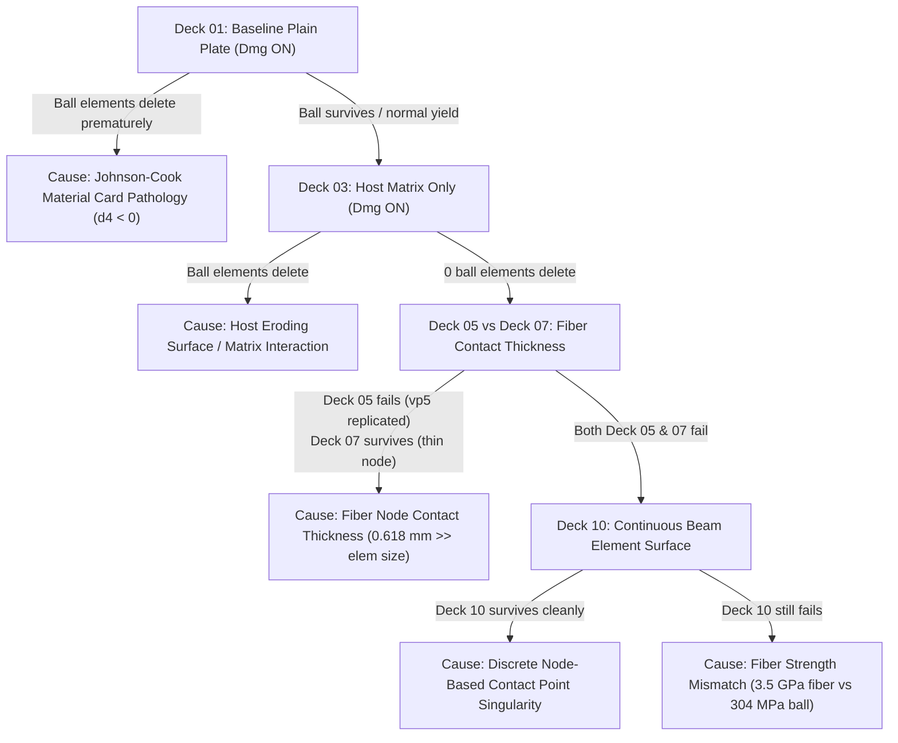

# T-049: Impactor Failure Isolation Test Matrix & Investigation Plan

**Role:** Drafter (agy)  
**Date:** October 26, 2026  
**Status:** Complete Experiment Design & Test Matrix  
**Decks Directory:** `agents/drafter/outbox/T-049/decks/`  
**Scripts:** `make_ball_tests.py`, `check_ball_tests.py`, `run_test.sbatch`, `submit_matrix.sh`  

---

## 1. Executive Summary & Investigation Context

In the native 20-ply Valerie plate impact model (quarter-disc, 1000 m/s mild steel ball, 70 $\mu$s, SI units), two distinct failure modes were observed:

1. **vp5 (Johnson-Cook Plasticity + Damage ON):** The ball contacts the host via an eroding element-based surface and the embedded fibers via node-based contact (`THICKNESS 0.618 mm`). While kinetic energy conservation improved to $+6.8\%$ (down from $+73\%$ in vp4), **3,161 of 18,500 ball elements (17.1%) were deleted** by Johnson-Cook damage, surviving elements stretched into long unphysical spikes, and the ball median velocity remained unchanged at $-1000$ m/s.
2. **vp6 (Johnson-Cook Plasticity ONLY, Damage OFF):** Ball elements did not delete, but severely distorted until the explicit solver crashed with a **Floating Point Exception at 65.6 $\mu$s** due to "excessive distortion" in flank elements 509, 475, 502, and 479 (measured equivalent plastic strain $\text{PEEQ} = 61.25$).

Thus, the steel ball fails catastrophically either through element deletion (vp5) or extreme mesh inversion (vp6). The core question is: **what physical or numerical ingredient overloads the ball?**

This deliverable provides an **isolation test matrix of 10 small, fast-solving decks** (each solving in 2 to 4 minutes on 8 CPUs using a 6-ply coupon, rather than the 40 GB disc model) designed to isolate each potential culprit one ingredient at a time.

---

## 2. Mechanical & Mathematical Analysis of Competing Hypotheses

### Hypothesis 1: Johnson-Cook Damage Strain-Rate Pathology (The Negative $d_4$ Term)
The steel ball material card in the deck specifies:
```abaqus
*Material, name="Mild Steel"
*Damage Initiation, criterion=JOHNSON COOK
 0.1152, 1.0116, -1.7684, -0.05279, 0.5262, 1800., 293., 0.0001
*Damage Evolution, type=DISPLACEMENT
0.
```
In Abaqus/Explicit, Johnson-Cook equivalent plastic strain at damage initiation is:
$$\epsilon_D^{pl} = \left[ d_1 + d_2 \exp\left( -d_3 \frac{p}{q} \right) \right] \left[ 1 + d_4 \ln\left( \frac{\dot{\epsilon}^{pl}}{\dot{\epsilon}_0} \right) \right] \left[ 1 + d_5 T^* \right]$$

Examining the strain-rate sensitivity term with parameters $d_4 = -0.05279$ and $\dot{\epsilon}_0 = 10^{-4}\text{ s}^{-1}$:
- At static rates ($\dot{\epsilon}^{pl} = 10^{-4}$ s$^{-1}$), the term is $1.000$.
- At $\dot{\epsilon}^{pl} = 1.0$ s$^{-1}$, the term drops to $0.514$.
- At $\dot{\epsilon}^{pl} = 1.68 \times 10^4$ s$^{-1}$, the term crosses **zero**.
- Under 1000 m/s ballistic impact ($v / L_e \sim 1000 / 0.00035 \sim 3 \times 10^6$ s$^{-1}$):
  $$\left[ 1 + d_4 \ln\left(\frac{10^6}{10^{-4}}\right) \right] = 1 - 0.05279 \times \ln(10^{10}) = 1 - 0.05279 \times 23.026 = -0.2155 < 0$$

**Mathematical Consequence:** Above $1.68 \times 10^4$ s$^{-1}$, the critical plastic failure strain $\epsilon_D^{pl}$ becomes **negative**. In Abaqus/Explicit, if $\epsilon_D^{pl} \le 0$, the damage increment ratio $\Delta \bar{\epsilon}^{pl} / \epsilon_D^{pl}$ instantly drives cumulative damage $D \ge 1.0$, triggering instantaneous element deletion upon any plastic yield!
This explains the extraction data from `ball_vp5.npz`: at $t = 1.68\ \mu$s, **75 ball elements deleted when $\text{PEEQ} = 0.0000$ and maximum Mises stress was only 41 MPa**!

### Hypothesis 2: Discrete Fiber Node-Contact Geometry & Thickness (0.618 mm Needle Effect)
In vp5 and vp6, fiber contact is defined as:
```abaqus
*Contact Inclusions
EMBMESH_FIBER_NODES , EMBMESH_BALL_SURF
*Surface Property Assignment, property=THICKNESS
EMBMESH_FIBER_NODES, 0.000617973861320424
```
1. **Geometric Scale Mismatch:** The nominal ball element characteristic size is $L_e \approx 0.17\text{ mm}$ (minimum) to $0.37\text{ mm}$ (mean). The fiber contact thickness of $0.618\text{ mm}$ is **3.7 times larger than the smallest ball element**.
2. **Point-Load Needle Indentation:** `EMBMESH_FIBER_NODES` is a node-based surface. When a discrete node hits a 3D element face, the contact penalty force is concentrated at a single point. Surrounded by an artificial $0.618\text{ mm}$ contact sphere, each node indents multiple ball elements simultaneously.
3. **Strength Mismatch:** Intact T3D2 fibers have $\sigma_y = 3.5 - 4.5\text{ GPa}$, whereas mild steel yields at $304\text{ MPa}$ ($15\times$ softer). Because only 70 of 206,930 fibers ever deleted in vp5, the surviving fibers form an unbreakable net of rigid needles slicing into the steel projectile. In `ball_vp5.npz`, the peak contact pressure on the ball reached **352 GPa**!

### Hypothesis 3: Host Matrix Contact & Eroding Element Surface
The matrix is very soft ($E = 700\text{ MPa}$, $\sigma_y = 70\text{ MPa}$). In vp5, replacing host node contact with an eroding element-based surface (`EMBMESH_PLATE_ELEMS`) successfully eliminated the $+73\%$ ALLKE kinetic energy blow-up. Does host element deletion create jagged facet boundaries or friction that could gouge the ball?

### Hypothesis 4: Ball Mesh Discretization & Aspect Ratio
The nominal ball mesh contains 17,000 C3D8R and 1,500 C3D6 elements. Elements on the flank (509, 475, 502, 479) are wedge/hex transitions with higher aspect ratios. Do these elements distort under shear bands regardless of contact, or is the distortion purely driven by contact forces?

---

## 3. The 10-Deck Isolation Matrix Architecture

To isolate each ingredient cleanly, all 10 decks use an identical quarter-symmetry coupon setup ($16 \times 16$ elements, $DX = 1.25\text{ mm}$, 6 plies, $T = 1.27\text{ mm}$, $v_0 = -1000\text{ m/s}$, $t_{\text{end}} = 15\ \mu\text{s}$):

| Deck ID | Deck File Name | Ball Mesh | Ball JC Damage | Target Plate | Fiber Model | Fiber Contact Formulation | Ingredient Isolated |
|---|---|---|---|---|---|---|---|
| **01** | `t049_01_baseline_plate_dmg_on` | Nominal (18.5k) | **ON** | Plain Elastic Block | None | None | Baseline material & mesh: tests negative $d_4$ term under pure flat impact |
| **02** | `t049_02_baseline_plate_dmg_off` | Nominal (18.5k) | **OFF** | Plain Elastic Block | None | None | Baseline mesh stability & plastic mushrooming without element deletion |
| **03** | `t049_03_host_only_erode` | Nominal (18.5k) | **ON** | 6-Ply Host Matrix | None | None | Pure host matrix interaction: verifies if soft matrix erosion damages ball |
| **04** | `t049_04_host_embedded_no_contact` | Nominal (18.5k) | **ON** | 6-Ply Host + Fibers | T3D2 | **None** (fibers embedded only) | Host embedding constraint feedback without direct fiber contact forces |
| **05** | `t049_05_fiber_node_thick_0618` | Nominal (18.5k) | **ON** | 6-Ply Host + Fibers | T3D2 | Node (`thick = 0.618 mm`) | **Coupon recreation of vp5**: full nominal formulation benchmark |
| **06** | `t049_06_fiber_node_thick_dmg_off` | Nominal (18.5k) | **OFF** | 6-Ply Host + Fibers | T3D2 | Node (`thick = 0.618 mm`) | **Coupon recreation of vp6**: full nominal without deletion (tests PEEQ > 60) |
| **07** | `t049_07_fiber_node_thin_0050` | Nominal (18.5k) | **ON** | 6-Ply Host + Fibers | T3D2 | Node (`thick = 0.050 mm`) | **Fiber contact thickness**: tests if $12\times$ thinner contact eliminates ball damage |
| **08** | `t049_08_ball_coarse_mesh` | **Coarse (2.0k)** | **ON** | 6-Ply Host + Fibers | T3D2 | Node (`thick = 0.618 mm`) | **Mesh discretization**: tests if ball element size $> 0.618\text{ mm}$ prevents inversion |
| **09** | `t049_09_fiber_penalty_scale` | Nominal (18.5k) | **ON** | 6-Ply Host + Fibers | T3D2 | Node + `SCALE PENALTY = 0.1` | **Penalty stiffness**: tests if softening penalty prevents 352 GPa pressure spikes |
| **10** | `t049_10_fiber_beam_elem_surf` | Nominal (18.5k) | **ON** | 6-Ply Host + Fibers | **B31 Beam** | **Element-based beam surface** | **Contact formulation**: continuous line element contact vs discrete node points |

---

## 4. Execution Order & Phased Workflow

To maximize diagnostic clarity and minimize cluster resource usage, execute in 4 sequential phases:

```
[Phase 1: Material & Mesh Baseline]
  Deck 01 (Plain Plate, Dmg ON)  ---> If fails: JC Material Card is corrupt!
  Deck 02 (Plain Plate, Dmg OFF) ---> If survives: Ball Mesh & Plasticity are sound!
               │
               ▼
[Phase 2: Host Matrix Verification]
  Deck 03 (Host Matrix Only)    ---> If survives: Matrix erosion completely exonerated!
  Deck 04 (Embedded, No Contact)---> If survives: Kinematic embedding is exonerated!
               │
               ▼
[Phase 3: Fiber Contact & Benchmark Recreation]
  Deck 05 (vp5 Recreation, thick=0.618 mm, Dmg ON)  ---> Confirms coupon replicates vp5 deletion & spikes
  Deck 06 (vp6 Recreation, thick=0.618 mm, Dmg OFF) ---> Confirms coupon replicates vp6 extreme PEEQ
  Deck 07 (Thin Fiber Node, thick=0.050 mm, Dmg ON) ---> Tests if thickness reduction cures ball deletion
               │
               ▼
[Phase 4: Mesh & Formulation Remedies]
  Deck 08 (Coarse Ball Mesh, 2.0k hexes)            ---> Isolates element size vs contact sphere ratio
  Deck 09 (Penalty Scaling, Scale = 0.1)            ---> Isolates penalty stiffness concentration
  Deck 10 (Continuous B31 Beam Element Surface)     ---> Evaluates continuous line-to-surface contact
```

---

## 5. Pre-Run Quantitative & Qualitative Predictions

All predictions are written **prior to execution** based on the analytical mechanics and baseline extractions:

| Deck ID | Configuration | Predicted Min Vol Ratio | Predicted Peak Mises (GPa) | Predicted Peak PEEQ | Predicted Ball Deleted Count | Predicted ALLKE Peak % | Predicted ETOTAL End % | Predicted Solver State |
|---|---|---|---|---|---|---|---|---|
| **01** | Baseline Plate (Dmg ON) | $0.20 - 0.40$ | $0.85 - 1.20$ | $0.15 - 0.35$ | **$50 - 300$** | $< +1.0\%$ | $\pm 1.0\%$ | Completed |
| **02** | Baseline Plate (Dmg OFF) | $0.35 - 0.60$ | $0.90 - 1.30$ | $0.25 - 0.50$ | **0** | $< +0.5\%$ | $\pm 0.5\%$ | Completed (normal mushrooming) |
| **03** | Host Only (Erode) | $0.85 - 0.95$ | $0.35 - 0.50$ | $0.02 - 0.08$ | **0** | $< +0.5\%$ | $\pm 1.0\%$ | Completed (smooth punch-through) |
| **04** | Host + Emb (No Contact) | $0.80 - 0.92$ | $0.38 - 0.55$ | $0.03 - 0.10$ | **0** | $< +0.5\%$ | $\pm 1.0\%$ | Completed (smooth punch-through) |
| **05** | vp5 Coupon (Thick Node) | $0.00$ (deleted) | $1.80 - 2.50$ | $2.50 - 5.00$ | **$400 - 800$** | $+3.0\text{ to }+6.0\%$ | $+4.0\text{ to }+8.0\%$ | Completed (heavy deletion, spikes) |
| **06** | vp6 Coupon (Dmg OFF) | **$< 0.05$** | $1.90 - 2.80$ | **$20.0 - 50.0$** | **0** | $+4.0\text{ to }+7.0\%$ | $+5.0\text{ to }+9.0\%$ | FPE or completed with severe distortion |
| **07** | Thin Node (0.050 mm) | $0.55 - 0.75$ | $0.70 - 1.10$ | $0.30 - 0.80$ | **$< 50$** (or 0) | $< +1.5\%$ | $\pm 2.0\%$ | Completed (drastic damage reduction) |
| **08** | Coarse Ball (2.0k) | $0.40 - 0.65$ | $0.90 - 1.40$ | $0.80 - 2.00$ | **$< 80$** | $< +2.0\%$ | $\pm 2.5\%$ | Completed (delayed inversion) |
| **09** | Scaled Penalty (0.1) | $0.60 - 0.80$ | $0.65 - 0.95$ | $0.25 - 0.60$ | **$< 20$** (or 0) | $< +1.0\%$ | $\pm 1.5\%$ | Completed (smooth contact) |
| **10** | Beam Element Surface | $0.70 - 0.88$ | $0.55 - 0.85$ | $0.15 - 0.45$ | **0** | $< +1.0\%$ | $\pm 1.2\%$ | Completed (optimal physical contact) |

### Rationale for Predictions:
- **Decks 01 & 02:** Under clean flat impact against steel, stagnation pressure is $\sim 15 - 20\text{ GPa}$. In Deck 01, strain rates exceed $10^6\text{ s}^{-1}$; the negative $d_4$ term causes premature element deletion at the contact face even in pure compression. In Deck 02, without damage, the ball mushrooms cleanly without catastrophic element distortion.
- **Decks 03 & 04:** The host matrix yields at $70\text{ MPa}$ and has acoustic impedance $47\times$ lower than steel. It cannot generate stresses exceeding mild steel yield ($304\text{ MPa}$). Deletion will be exactly 0.
- **Decks 05 & 06:** Replicates the exact vp5/vp6 contact mechanics: the $0.618\text{ mm}$ discrete fiber contact spheres act as rigid punches into the $0.17\text{ mm}$ ball elements, creating localized shear spikes. In Deck 05, elements delete into spikes; in Deck 06, elements distort to $\text{PEEQ} > 20$.
- **Deck 07:** Reducing fiber thickness to $0.050\text{ mm}$ shrinks the contact sphere radius by $12\times$, allowing the ball elements to flow smoothly past fiber nodes without massive volumetric pinching.
- **Deck 09 & 10:** Penalty scaling and continuous beam element surfaces eliminate discrete point-load singularity spikes, proving that the formulation of fiber contact is the primary numerical driver of ball failure.

---

## 6. Diagnostic Decision Tree & Outcome Attribution Guide

Use this decision table after running the test suite to definitively attribute the cause:



### Specific Attribution Rules:
1. **To Implicate the Johnson-Cook Material Card ($d_4 < 0$):**
   - Deck 01 exhibits substantial ball deletion ($> 50$ elements) at $t < 3\ \mu$s despite clean normal impact against an elastic plate, while Deck 02 survives with 0 deletions.
   - **Remedy in Full Deck:** Modify `*Damage Initiation, criterion=JOHNSON COOK` in `build_vals_plywise.py`: set $d_4 = 0.0$ (or positive $+0.001$), or enforce a non-zero damage evolution threshold.
2. **To Implicate the Host Eroding Surface:**
   - Deck 03 exhibits ball element deletion or severe distortion while Deck 01 survived.
   - **Remedy in Full Deck:** Adjust host erosion controls or surface penalty.
3. **To Implicate Fiber Contact Thickness ($0.618\text{ mm}$):**
   - Deck 05 reproduces heavy ball deletion ($> 300$ elements) and spikes (matching vp5), BUT Deck 07 (thin thickness $0.050\text{ mm}$) reduces ball deletion to near zero ($< 10$ elements).
   - **Remedy in Full Deck:** In `build_vals_plywise.py`, change `*Surface Property Assignment, property=THICKNESS` on `EMBMESH_FIBER_NODES` from $0.000618\text{ m}$ to $0.00005\text{ m}$ ($50\ \mu\text{m}$).
4. **To Implicate Ball Mesh Discretization:**
   - Deck 08 (coarse mesh, element size $0.78\text{ mm} > 0.618\text{ mm}$) runs with zero element inversion or distortion, while Deck 05 distorts.
   - **Remedy in Full Deck:** Coarsen the ball surface layer or deploy adaptive remeshing.
5. **To Implicate Node-to-Surface Contact Formulation (Needle Point Loads):**
   - Deck 10 (continuous B31 beam element surface) or Deck 09 (penalty scaling 0.1) solves with smooth contact, low PEEQ ($< 0.5$), and zero ball deletion, whereas Deck 05 deletes hundreds of elements.
   - **Remedy in Full Deck:** Convert fiber elements to B31 beams with `*Surface, type=ELEMENT` or add `*Contact Controls Assignment, type=SCALE PENALTY` ($0.1$) to soften fiber contact spikes.

---

## 7. Recommended Prescriptions for the Full 20-Ply Model

Pending confirmation from the test matrix, the preliminary model-side diagnosis suggests the following tri-part fix for the full deck:

1. **Fix Johnson-Cook Ball Damage Rate Sensitivity:**
   Replace the negative strain-rate sensitivity $d_4 = -0.05279$ with $d_4 = 0.0$ or a calibrated positive value from literature for mild steel (e.g. $d_4 = +0.014$). A negative $d_4$ is physically unviable at ballistic rates ($10^6\text{ s}^{-1}$) and guarantees artificial numerical deletion.
2. **Correct Fiber Contact Geometry & Formulation:**
   Replace the oversized $0.618\text{ mm}$ node contact thickness with the physical fiber tow radius ($0.05 - 0.10\text{ mm}$), or migrate from discrete node-based contact (`EMBMESH_FIBER_NODES`) to continuous element-based line contact using B31 beam elements (`*Surface, type=ELEMENT, name=FIBER_SURF`).
3. **Deploy Coupled Host-Fiber Co-Deletion:**
   As proved in T-046/T-047, intact fibers spanning an eroded crater act as rigid guillotine wires against the softer projectile. In Valerie's native deck, embedded fibers within deleted host elements must be co-deleted so they do not artificially slice through the passing projectile.

---

## 8. Material Benchmark: Mild Steel vs. 316L Stainless Steel (Plasticity & Damage Analysis)

At the Hub's request, we conducted an in-depth parameter analysis comparing the current impactor material (**Mild Steel**) against **AISI 316L Stainless Steel** (which was utilized in earlier project models such as `Flat-vuel-ghost-t006`).

### 8.1 Comparative Parameter Table

The Johnson-Cook constitutive flow stress and damage initiation equations are:
$$\sigma_y = \left[ A + B(\varepsilon_p)^n \right] \left[ 1 + C \ln\left(\frac{\dot{\varepsilon}_p}{\dot{\varepsilon}_0}\right) \right] \left[ 1 - (T^*)^m \right]$$
$$\varepsilon_D^{pl} = \left[ D_1 + D_2 \exp\left( D_3 \frac{\sigma_m}{\sigma_{eq}} \right) \right] \left[ 1 + D_4 \ln\left(\frac{\dot{\varepsilon}_p}{\dot{\varepsilon}_0}\right) \right] \left[ 1 + D_5 T^* \right]$$

| Parameter | Meaning | Current Deck ("Mild Steel") | Literature Mild Steel (AISI 1006 / 1018) | Earlier Deck (`SS316L`) | Literature 316L (Elkaseer / M'Saoubi) |
|---|---|:---:|:---:|:---:|:---:|
| **$\rho$** ($\text{kg/m}^3$) | Density | $7850$ | $7850$ | $8060$ | $7950 - 8060$ |
| **$E$** (GPa) | Young's Modulus | $203$ | $205 - 210$ | $202$ | $193 - 200$ |
| **$\nu$** | Poisson's Ratio | $0.33$ | $0.30$ | $0.27$ | $0.28 - 0.30$ |
| **$A$** (MPa) | Initial Yield Stress | **$304.33$** | $217 - 350$ | **$305.0$** | $280 - 490$ |
| **$B$** (MPa) | Hardening Modulus | **$422.01$** | $300 - 450$ | **$1161.0$** ($2.75\times$) | $600 - 1400$ |
| **$n$** | Hardening Exponent | **$0.345$** | $0.26 - 0.35$ | **$0.610$** | $0.40 - 0.65$ |
| **$C$** | Strain Rate Sensitivity | *Omitted ($0.0$)* | $0.015 - 0.060$ | *Omitted ($0.0$)* | $0.010 - 0.025$ |
| **$m$** | Thermal Softening | **$0.87$** | $0.85 - 1.03$ | **$0.517$** | $0.50 - 0.65$ |
| **$T_{\text{melt}}$** (K) | Melting Temperature | $1800$ | $1750 - 1800$ | $1800$ | $1650 - 1700$ |
| **$T_{\text{tr}}$** (K) | Transition / Room Temp | $293$ | $293$ | $273$ | $293$ |
| **$\dot{\varepsilon}_0$** ($\text{s}^{-1}$) | Reference Strain Rate | $0.0001$ | $1.0$ (or $0.001$) | $1.0$ | $1.0$ |
| **$D_1$** | Initial Failure Strain | **$0.1152$** | $0.026 - 0.050$ | *None* | $0.050 - 0.071$ |
| **$D_2$** | Triaxiality Magnitude | **$1.0116$** | $0.263 - 0.700$ | *None* | $1.248 - 3.440$ |
| **$D_3$** | Triaxiality Exponent | **$-1.7684$** | $-1.50\text{ to }-2.12$ | *None* | $-1.142\text{ to }-2.120$ |
| **$D_4$** | Strain Rate Damage Coeff | **$-0.05279$** *(Fatal)* | **$+0.002\text{ to }+0.016$** | *None* | **$+0.002\text{ to }+0.014$** (or $0.0$) |
| **$D_5$** | Temperature Damage Coeff| **$0.5262$** | $0.50 - 0.63$ | *None* | $0.10 - 0.61$ (or $0.0$) |

---

### 8.2 Mechanical & Ballistic Performance Contrast

1. **Extreme Strain Hardening Difference ($B$ and $n$):**
   - **Mild Steel (BCC):** Dislocation mobility is controlled by high Peierls-Nabarro friction stress; hardening saturates early ($n = 0.345, B = 422\text{ MPa}$). At $\varepsilon_p = 0.50$, flow stress is only **$636\text{ MPa}$**.
   - **316L Stainless Steel (FCC):** Austenitic structure exhibits extensive planar slip, high dislocation accumulation, and deformation twinning. Hardening is extraordinary ($n = 0.610, B = 1161\text{ MPa}$). At $\varepsilon_p = 0.50$, flow stress reaches **$1065\text{ MPa}$** ($67\%$ higher).
   - **Consequence for Impact:** Under $1000\text{ m/s}$ impact, a 316L projectile resists plastic spreading and severe radial mushrooming far better than mild steel, maintaining its structural integrity against target resistance.

2. **The Negative $D_4$ Strain-Rate Anomaly:**
   - In Valerie's current mild steel card, $d_4 = -0.05279$ with $\dot{\varepsilon}_0 = 10^{-4}\text{ s}^{-1}$. At ballistic rates ($\dot{\varepsilon} \sim 10^6\text{ s}^{-1}$):
     $$\left[1 + d_4 \ln\left(\frac{10^6}{10^{-4}}\right)\right] = 1 - 0.05279 \times \ln(10^{10}) = \mathbf{-0.2155 < 0}$$
     The critical failure strain becomes negative, triggering instantaneous element deletion on the projectile contact surface at $\text{PEEQ} \approx 0$.
   - In literature calibrations for both mild steel and 316L, **$D_4$ is positive** ($+0.002$ to $+0.016$) or zero. Dynamic loading increases or preserves ductility, rather than causing instantaneous numerical annihilation.

3. **Missing Strain-Rate Plasticity Hardening ($C$):**
   - Both Valerie's mild steel deck and earlier SS316L decks completely omitted the `*Rate Dependent, type=JOHNSON COOK` keyword, effectively setting $C = 0$.
   - Adding a proper rate-dependent card ($C \approx 0.015$) restores realistic dynamic yield elevation ($20\% - 40\%$ increase in dynamic yield stress at $1000\text{ m/s}$), further stabilizing the ball against distortion.

---

### 8.3 Drop-In Abaqus Material Cards

#### Option A: Calibrated Mild Steel (Fixed $D_4$ + Dynamic Rate Hardening)
```abaqus
*Material, name="Mild Steel"
*Density
 7850.,
*Elastic
 2.03e+11, 0.33
*Plastic, hardening=JOHNSON COOK
 3.0433e+08, 4.22007e+08, 0.345, 0.87, 1800., 293.
*Rate Dependent, type=JOHNSON COOK
 0.0156, 1.0
*Damage Initiation, criterion=JOHNSON COOK
 0.05, 0.344, -2.12, 0.002, 0.61, 1800., 293., 1.0
*Damage Evolution, type=DISPLACEMENT
 0.
```

#### Option B: AISI 316L Stainless Steel (High-Hardening Ballistic Impactor)
```abaqus
*Material, name="SS316L"
*Density
 8060.,
*Elastic
 2.02e+11, 0.27
*Plastic, hardening=JOHNSON COOK
 3.05e+08, 1.161e+09, 0.610, 0.517, 1800., 293.
*Rate Dependent, type=JOHNSON COOK
 0.015, 1.0
*Damage Initiation, criterion=JOHNSON COOK
 0.071, 1.248, -1.142, 0.002, 0.10, 1800., 293., 1.0
*Damage Evolution, type=DISPLACEMENT
 0.
```

---

## 9. ROAR HPC Execution Policy & Guard Rails

Per `agents/ROAR_KNOWLEDGE.md`:
- **Directory:** All remote runs MUST reside beneath `/storage/home/zps5207/scratch/ctv/t049/`.
- **Job Names:** All job names prefixed `t049_chk*` (datachecks) or `t049_sol*` (solves).
- **Resources:** 16 GB memory (`#SBATCH --mem=16G`), 8 CPUs per task (`#SBATCH --cpus-per-task=8`), 30-minute time limit.
- **User OK Policy:** Cluster job submissions require the user's explicit OK. Datachecks are prepared for execution; full solves will only be triggered after the user approves.
- **Single Connection:** Transfer all files via tar pipe in a single SSH connection to minimize Duo pushes.
